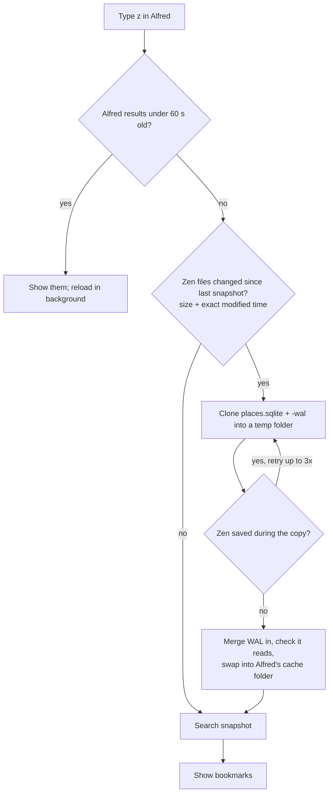

# Zen Bookmarks Search (Alfred Workflow)

Search your Zen browser bookmarks from Alfred.

## Features
- Search the default Zen profile's bookmarks by title, URL, tags and page description
- Open in the primary or secondary browser (configurable)
- Large Type view of tags and full URL
- Hide a bookmark by tagging it `Exclude-Alfred` (case sensitive)

## Usage
* <kbd>z</kbd> Trigger the workflow
* <kbd>↩</kbd> Open in the primary browser
* <kbd>⇧</kbd><kbd>⌘</kbd><kbd>↩</kbd> Open in the primary browser without closing Alfred
* <kbd>⌘</kbd><kbd>↩</kbd> Open in the secondary browser
* <kbd>⌘</kbd><kbd>L</kbd> Show all tags and the full URL in Large Type
* <kbd>⇧</kbd> Hold to show the bookmark description

## How it works

Zen keeps `places.sqlite` exclusively locked while it runs and writes recent changes to `places.sqlite-wal` first, so the workflow searches its own snapshot of both, rebuilt only when Zen has saved something.

| Case | Time | Cost |
|---|---|---|
| Nothing changed | ~0.02 s | One small query, ~4 MB memory |
| Zen saved a change | ~0.1–0.25 s | APFS clone copy (shares disk blocks with Zen's file) plus a WAL merge |
| Between searches | — | Nothing runs |

New bookmarks show up on the next search, or up to a minute later while Alfred shows cached results. Only the default Zen profile is searched; change it in Zen's Profile Manager.

## Requirements
- Alfred 5.5+ with the Powerpack
- `jq` (built into macOS 15 and later)

## Installation
1. Clone this repo into your Alfred workflows folder.
2. In Alfred → Workflows → Zen Bookmarks, set the keyword, the secondary browser and an optional hotkey.

## License

Derived from [alfred-firefox-bookmarks](https://github.com/FireFingers21/alfred-firefox-bookmarks) by FireFingers21; see that repository for its license.
